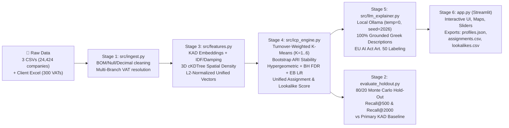

# 🎯 Archimedes2026 — ForceCRM B2B Profile Analysis & Lookalike Engine

**NKUA Hackathon (Nov 2026) · ForceCRM Challenge**  
*Local AI B2B Customer Segmentation, Statistical Proof & Lookalike Discovery for Greek Hospitality Businesses (Main KAD 56, 2020–2024, 24,424 Records)*

---

## 1. Architecture Overview

Our system follows a **Deterministic Math First, Local LLM Last** architecture designed to run 100% locally on consumer hardware (zero external AI APIs) while complying with the **EU AI Act (Section 9)** and all **System Requirements (A1–A8, X1)**:



### Repository Structure
| File / Module | Role |
| :--- | :--- |
| [`src/config.py`](src/config.py) | Central `PipelineConfig` dataclass and `EMBEDDING_MODELS_REGISTRY` holding all tunable weights, priors, and model settings. |
| [`src/ingest.py`](src/ingest.py) | **Stage 1:** Parses `;`-delimited UTF-8 CSVs and Client Excel, preserves 9-digit `vat` leading zeros, resolves the `2026-03-01` multi-Primary-KAD NACE 2.1 transition, computes `branch_count`, and flags all client VAT branches. |
| [`src/features.py`](src/features.py) | **Stage 3:** Embeds the 3,736 unique Greek KAD descriptions (with disk caching in `output/cache/`), builds IDF + activity-type weighted L2-normalized company vectors, and computes 3D spherical `cKDTree` spatial density features. |
| [`src/icp_engine.py`](src/icp_engine.py) | **Stage 4:** Discovers 1 to 6 ICPs (`K = 1..6`) weighted by client turnover, measures Bootstrap ARI stability, proves defining traits via Hypergeometric tests + Benjamini-Hochberg FDR + Empirical Bayes Shrinkage Lift, and ranks lookalikes & client assignments. |
| [`src/llm_explainer.py`](src/llm_explainer.py) | **Stage 5:** Generates reproducible (`temperature=0`, `seed=2026`) Greek ICP narratives strictly grounded in `profiles.json` metrics via local Ollama (with automatic offline fallback to our deterministic grounded Greek generator). |
| [`evaluate_holdout.py`](evaluate_holdout.py) | **Stage 2:** Objective 80/20 Monte Carlo Hold-Out benchmark measuring `Recall@500` and `Recall@2000` against the official ForceCRM Primary KAD frequency baseline. |
| [`app.py`](app.py) | **Stage 6:** Localhost Streamlit + Plotly web application for uploading the client Excel, tuning parameters live, exploring interactive maps/charts, and exporting the Section 10 deliverables. |

---

## 2. How to Install & Run the Program

### Prerequisites
- Python `>=3.12` (managed via `uv` and pre-configured in `.venv/`).
- Data files placed in `data/`:
  - `data/vwHackCompany.csv` (24,424 hospitality company records)
  - `data/vwHackCompanyActivity.csv` (161,964 company-activity links)
  - `data/vwHackActivities.csv` (3,736 unique 8-digit KAD descriptions)
  - `data/ForceCRM_Hackathon_Pelatologio.xlsx` (300 client VATs and indicative turnover)

### One-Command Execution (Section 6 & 10)
To launch the full interactive Web Application on `http://localhost:8501` (which also automatically exports `output/profiles.json`, `output/assignments.csv`, and `output/lookalikes.csv`):

```bash
.venv/bin/streamlit run app.py
```

### Running Individual CLI Stages & Custom Benchmarks

#### 1. Verify Data Ingestion & Sanity Assertions
```bash
.venv/bin/python -m src.ingest
```

#### 2. Run Feature Engineering & Multi-KAD Fairness Diagnostics
```bash
# Default fast deterministic Greek morphological SVD model:
.venv/bin/python -m src.features --embedding-model char-ngram-svd

# Or run with local neural sentence-transformers (granite-107m, granite-278m, e5-small, e5-base):
.venv/bin/python -m src.features --embedding-model granite-107m --w-primary 3.5 --w-secondary 0.75 --idf-power 1.25
```

#### 3. Generate ICPs, Statistical Proofs, Greek AI Descriptions & Export Deliverables
```bash
.venv/bin/python -m src.llm_explainer
```
This writes the three required automated evaluation files into `output/`:
- `output/profiles.json`
- `output/assignments.csv`
- `output/lookalikes.csv`

#### 4. Run the Hold-Out Evaluation Benchmark (`Recall@500` & `Recall@2000`)
```bash
# Default 5-split 80/20 Monte Carlo Hold-Out evaluation:
.venv/bin/python evaluate_holdout.py --splits 5

# Custom hyperparameter ablation from the CLI:
.venv/bin/python evaluate_holdout.py \
  --embedding-model char-ngram-svd \
  --splits 10 \
  --min-icps 1 \
  --max-icps 6 \
  --w-primary 3.5 \
  --w-secondary 0.75 \
  --w-cos 0.20 \
  --w-eb 0.55 \
  --w-spatial 0.25 \
  --eb-prior 6.0 \
  --bandwidth-km 12.0
```

---

## 3. Exact Mathematical Formulations, Weights & Calculations

Below is the complete mathematical specification of how every weight, vector, statistical test, and similarity score is computed across the pipeline.

---

### 3.1 Multi-Branch VAT Resolution & Canonical Primary KAD (`src/ingest.py`)

1. **Multi-Branch VAT Feature (`branch_count`):**
   A single Greek tax ID (`vat` / ΑΦΜ) can correspond to multiple store rows (`company_id`) in `vwHackCompany.csv`. For each `vat`, we compute `vat_total_locations` $L_{\text{tot}}(v)$ and `vat_branch_count` $L_{\text{br}}(v)$:

$$
L_{\text{tot}}(v) = |\{i : \text{vat}_i = v\}|, \quad L_{\text{br}}(v) = \sum_{i : \text{vat}_i = v} \mathbb{I}(\text{branch}_i = 1)
$$

$$
B_i = \max\big(L_{\text{br}}(\text{vat}_i),\; L_{\text{tot}}(\text{vat}_i) - 1\big)
$$

   **Strict Lookalike Exclusion Trap:** Every `company_id` whose `vat` appears in the client Excel is flagged with `is_client_vat = True`. When generating `lookalikes.csv`, **all** rows with `is_client_vat == True` (both headquarters and every branch) are strictly excluded from the candidate pool.

2. **Canonical Primary KAD (`primary_kad`):**
   Due to the `2026-03-01` NACE 2.1 transition, 993 companies have more than 1 row marked `Κύρια` in `vwHackCompanyActivity.csv`. To ensure every hospitality company has a clean canonical Primary KAD while losing zero information:
   - We sort each company's `Κύρια` rows by: (1) starts with `"56"` (Food & Beverage service activities) first, (2) earliest `date_from` first, (3) lowest `activity_id` tie-breaker.
   - All declared primary and secondary KADs remain active in `all_kads` for semantic embedding.

---

### 3.2 Semantic KAD Embeddings & Multi-KAD Noise Suppression (`src/features.py`)

Businesses in the dataset declare between **1 and 239 KADs** (mean `6.63`). Many secondary KADs (`Δευτερεύουσα`) are declarative noise, and **Requirement A3** mandates that companies with many KADs must never be penalized by the similarity metric.

#### Step 1: Unique KAD Description Embeddings
Each of the $M = 3,736$ unique 8-digit KAD codes $a \in \{1, \dots, M\}$ is formatted with its 4-digit category prefix and Greek description (`"ΚΑΔ 5611.0100: <description>"`) and embedded once into an L2-normalized vector $\mathbf{e}_a \in \mathbb{R}^{D_{\text{emb}}}$ ($\|\mathbf{e}_a\|_2 = 1$).

#### Step 2: Smooth Inverse Document Frequency ($\text{IDF}_a$)
Let $N = 24,424$ be the total number of companies and $\text{df}_a$ be the number of companies declaring KAD $a$. To suppress ubiquitous, uninformative secondary KADs, we compute smooth IDF with exponent $\gamma_{\text{idf}} = 1.25$ (`idf_power`):

$$
\text{IDF}_a = \left(\ln\left(\frac{1 + N}{1 + \text{df}_a}\right) + 1.0\right)^{\gamma_{\text{idf}}}
$$

#### Step 3: Activity-Type Weighting & Sublinear Secondary Damping
For company $i$ and declared activity $a$ with normalized activity type $t_{i,a}$ (`Κύρια`, `Δευτερεύουσα`, or `Βοηθητική`), let $n_{\text{sec}}(i) \ge 1$ be the number of non-primary KADs declared by company $i$. The base weight $w_{\text{type}}(i, a)$ is:

$$
w_{\text{type}}(i, a) = \begin{cases}
w_{\text{prim}} = 3.50 & \text{if primary (Κύρια)} \\
w_{\text{sec}} / n_{\text{sec}}(i)^{\delta} = 0.75 / n_{\text{sec}}(i)^{0.35} & \text{if secondary (Δευτερεύουσα)} \\
w_{\text{aux}} / n_{\text{sec}}(i)^{\delta} = 0.25 / n_{\text{sec}}(i)^{0.35} & \text{if auxiliary (Βοηθητική)}
\end{cases}
$$

where $\delta = 0.35$ (`secondary_count_damping`) prevents a company with 100+ secondary KADs from having its primary KAD drowned out by secondary noise.

#### Step 4: Sparse Aggregation & L2 Normalization
The total link weight is $W_{i,a} = w_{\text{type}}(i, a) \cdot \text{IDF}_a$. The company's semantic activity vector $\mathbf{v}_i^{\text{sem}}$ is computed via sparse matrix multiplication and **L2-normalized**:

$$
\tilde{\mathbf{v}}_i^{\text{sem}} = \sum_{a \in \mathcal{A}(i)} W_{i,a}\,\mathbf{e}_a, \qquad \mathbf{v}_i^{\text{sem}} = \frac{\tilde{\mathbf{v}}_i^{\text{sem}}}{\|\tilde{\mathbf{v}}_i^{\text{sem}}\|_2}
$$

We then project $\mathbf{v}_i^{\text{sem}}$ onto its top $D_{\text{svd}} = 24$ principal components via TruncatedSVD and L2-normalize to obtain $\mathbf{u}_i^{\text{sem}} \in \mathbb{R}^{24}$ ($\|\mathbf{u}_i^{\text{sem}}\|_2 = 1$). Because every company vector has unit L2 norm ($\|\mathbf{u}_i^{\text{sem}}\|_2 = 1$), **multi-KAD companies suffer zero length or cosine penalty**.

---

### 3.3 Spatial `cKDTree`, Legal, Age & Unified Feature Vector (`src/features.py`)

To satisfy **Requirement A1** and **Extra Point X1 (Geographic ICP)**, we construct four additional L2-normalized feature blocks for each company $i$:

1. **Spatial GPS & 3D `cKDTree` Density Block ($\mathbf{u}_i^{\text{spat}}, \|\mathbf{u}_i^{\text{spat}}\|_2 = 1$):**
   - Valid GPS coordinates $(\phi_i, \lambda_i)$ in radians are mapped onto the 3D unit sphere:

$$
\mathbf{x}_i = (\cos\phi_i\cos\lambda_i,\; \cos\phi_i\sin\lambda_i,\; \sin\phi_i) \in S^2 \subset \mathbb{R}^3
$$

   - For radii $r \in \{1\text{ km}, 5\text{ km}, 20\text{ km}\}$, the exact spherical chord threshold is $c(r) = 2\sin\big(\frac{r}{2R_{\oplus}}\big)$ where $R_{\oplus} = 6371.0088\text{ km}$.
   - Using `scipy.spatial.cKDTree.query_ball_point`, we count the number of neighboring hospitality businesses $N_r(i)$ within radius $r$, apply $\ln(1 + \max(N_r(i)-1, 0))$, standardize ($z$-score), and combine with standardized $(\phi_i, \lambda_i)$ and major Prefecture (`prefecture_name`) indicators.

2. **KAD Hierarchy Block ($\mathbf{u}_i^{\text{kad}}, \|\mathbf{u}_i^{\text{kad}}\|_2 = 1$):**
   One-hot encoding of the 4-digit NACE class (`5611`, `5621`, `5622`, `5630`, etc.) and top 30 8-digit Primary KADs, L2-normalized.

3. **Legal Type Block ($\mathbf{u}_i^{\text{leg}}, \|\mathbf{u}_i^{\text{leg}}\|_2 = 1$):**
   One-hot encoding of `legal_type` (`ΑΤΟΜΙΚΗ`, `ΙΚΕ`, `ΕΕ`, `ΟΕ`, `ΑΕ`, `ΕΠΕ`, `OTHER`), L2-normalized.

4. **Company Age & Branch Block ($\mathbf{u}_i^{\text{age}}, \|\mathbf{u}_i^{\text{age}}\|_2 = 1$):**
   Standardized `company_age_years` (years from `incorporation_date` to Nov 2026), binary `is_branch`, and standardized $\ln(1 + B_i)$, L2-normalized.

#### Unified Company Vector ($\mathbf{z}_i$)
We concatenate the five unit-norm blocks using the block weights in `PipelineConfig` and apply final L2 normalization:

$$
\tilde{\mathbf{z}}_i = \big(\beta_{\text{sem}}\mathbf{u}_i^{\text{sem}},\; \beta_{\text{kad}}\mathbf{u}_i^{\text{kad}},\; \beta_{\text{spat}}\mathbf{u}_i^{\text{spat}},\; \beta_{\text{leg}}\mathbf{u}_i^{\text{leg}},\; \beta_{\text{age}}\mathbf{u}_i^{\text{age}}\big)
$$

$$
\mathbf{z}_i = \frac{\tilde{\mathbf{z}}_i}{\|\tilde{\mathbf{z}}_i\|_2}, \qquad (\beta_{\text{sem}}=1.00,\; \beta_{\text{kad}}=0.85,\; \beta_{\text{spat}}=1.15,\; \beta_{\text{leg}}=0.90,\; \beta_{\text{age}}=0.45)
$$

---

### 3.4 Turnover-Weighted ICP Discovery & Bootstrap Stability (`src/icp_engine.py`)

1. **Client Turnover Weighting (Requirement A2):**
   Given client $j \in \{1, \dots, N_c\}$ with turnover $T_j > 0$, we compute raw log-turnover weights $\tilde{w}_j = \ln(1 + T_j)$, normalize by their mean $\bar{w} = \frac{1}{N_c}\sum_j \tilde{w}_j$, and blend with uniform weights using $\alpha = 0.50$ (`turnover_weight_alpha`):

$$
w_j = (1 - \alpha)\cdot 1.0 + \alpha \cdot \frac{\tilde{w}_j}{\bar{w}}
$$

   This gives higher-revenue clients stronger pull on ICP formation while preventing a single extreme-turnover outlier from hijacking a cluster.

2. **Selecting Optimal $K \in [1, 6]$ (Including $K=1$ Homogeneity Check):**
   - For each $K \in \{2, \dots, 6\}$, we fit sample-weighted K-Means on the L2-normalized client vectors $\{\mathbf{z}_j\}$ and compute the cosine Silhouette score $\text{Sil}(K)$ (with a mild penalty if any cluster has fewer than 12 clients).
   - If $\max_{K \ge 2} \text{Sil}(K) < \tau_{\text{homog}} = 0.08$, the system returns **$K = 1$ («ένα ICP»)** per Requirement A2. Otherwise, it selects $K^* = \arg\max_K \text{Sil}(K)$.

3. **Bootstrap Stability & Adjusted Rand Index (Requirement A5):**
   - Over $B = 30$ bootstrap iterations, we draw an 85% subsample without replacement, refit weighted K-Means with $K^*$, and compute:
     - **Global ARI:** Mean `adjusted_rand_score` between the full-sample assignments and bootstrap assignments on the subsampled clients.
     - **Per-Profile Stability ($\text{Stab}_k \in [0, 1]$):** For each profile $k$, we match it to its closest bootstrap cluster $k'(b)$ and average $0.5 \cdot \text{Jaccard}(C_k, C_{k'}^{(b)}) + 0.5 \cdot \max(0, \cos(\boldsymbol{\mu}_k, \boldsymbol{\mu}_{k'}^{(b)}))$ across all $B$ runs.

---

### 3.5 Statistical Proof: Hypergeometric Test, BH-FDR & Empirical Bayes Shrinkage (`src/icp_engine.py`)

To satisfy **Requirement A4** (*"Τα χαρακτηριστικά που ορίζουν ένα profile υπερεκπροσωπούνται με στατιστικά ελεγμένο τρόπο... Σπάνια χαρακτηριστικά δεν περνούν από τύχη"*), every categorical trait $f$ (Prefecture, Municipality, Legal Type, 8-digit Primary KAD, 4-digit KAD Class, Age Bracket, Branch Structure) in each ICP $k$ is evaluated against the $N = 24,424$ Universe:

1. **Exact Hypergeometric Test ($p_{\text{raw}}$):**
   Let $N = 24,424$ be the Universe size, $K_{\text{univ}}(f)$ be the count of companies in the Universe having trait $f$, $n_k$ be the number of clients in ICP $k$, and $x_{k,f}$ be the number of clients in ICP $k$ having trait $f$. The exact probability of observing at least $x_{k,f}$ successes by chance is the Hypergeometric survival function:

$$
p_{\text{raw}}(k, f) = \mathbb{P}(X \ge x_{k,f}) = \sum_{i = x_{k,f}}^{\min(n_k, K_{\text{univ}}(f))} \frac{\binom{K_{\text{univ}}(f)}{i}\binom{N - K_{\text{univ}}(f)}{n_k - i}}{\binom{N}{n_k}}
$$

2. **Benjamini-Hochberg FDR Correction ($p_{\text{FDR}}$):**
   Across all $m$ candidate traits tested in ICP $k$, we sort the raw $p$-values $p_{(1)} \le p_{(2)} \le \dots \le p_{(m)}$ and compute false-discovery-rate adjusted $p$-values:

$$
p_{\text{FDR}}^{(r)} = \min_{j \ge r} \left(1.0,\; \frac{m}{j}\, p_{(j)}\right)
$$

3. **Empirical Bayes Shrinkage Lift ($\text{Lift}_{\text{EB}}$):**
   Raw lift $\frac{x_{k,f}/n_k}{K_{\text{univ}}(f)/N}$ explodes on rare traits (e.g., if $K_{\text{univ}}(f) = 2$ and $x_{k,f} = 1$, raw lift is $>80\times$ purely by chance). We place a Beta-Binomial prior centered at the Universe baseline rate $p_{\text{univ}}(f) = \frac{K_{\text{univ}}(f)}{N}$ with prior strength $m_{\text{prior}} = 10.0$ (`eb_prior_strength`):

$$
\hat{p}_{\text{EB}}(k, f) = \frac{x_{k,f} + m_{\text{prior}} \cdot p_{\text{univ}}(f)}{n_k + m_{\text{prior}}}, \qquad \text{Lift}_{\text{EB}}(k, f) = \frac{\hat{p}_{\text{EB}}(k, f)}{p_{\text{univ}}(f)}
$$

   This shrinks small-sample estimates smoothly toward $1.0\times$ while preserving high-evidence lifts.

---

### 3.6 Unified B2B Commercial Fit / Lookalike & Assignment Score (`src/icp_engine.py`)

Per **Requirements A3 & A7**, the **exact same similarity metric** $S(i, k) \in [0, 1]$ is used to assign existing clients to profiles (`assignments.csv`) and to rank non-client Universe candidates (`lookalikes.csv`).

For any company $i$ and ICP $k$, $S(i, k)$ is a convex combination of three normalized components:

$$
S(i, k) = \frac{w_{\text{cos}}\,S_{\text{cos}}(i, k) + w_{\text{eb}}\,S_{\text{EB}}(i, k) + w_{\text{sp}}\,S_{\text{spat}}(i)}{w_{\text{cos}} + w_{\text{eb}} + w_{\text{sp}}}
$$

1. **Feature Cosine Similarity ($S_{\text{cos}}(i, k) \in [0, 1]$):**

$$
S_{\text{cos}}(i, k) = \frac{\mathbf{z}_i^\top \boldsymbol{\mu}_k + 1}{2}
$$

   where $\mathbf{z}_i$ is company $i$'s L2-normalized unified feature vector and $\boldsymbol{\mu}_k$ is ICP $k$'s L2-normalized turnover-weighted centroid.

2. **Empirical Bayes Log-Lift Affinity ($S_{\text{EB}}(i, k) \in [0, 1]$):**
   For each categorical attribute $c$ (`prefecture_name`, `municipality_name`, `legal_type`, `primary_kad`, `kad_4digit`, `age_bracket`, `branch_status`), let $\ell_k(c, v_c(i)) = \ln\big(\text{clip}(\text{Lift}_{\text{EB}}(k, v_c(i)), 0.25, 8.0)\big)$ be the blended ICP + portfolio Empirical Bayes log-lift for company $i$'s value $v_c(i)$. We sum the weighted log-lifts and pass through a logistic sigmoid:

$$
L_{\text{EB}}(i, k) = \sum_{c} \gamma_c \,\ell_k(c, v_c(i)), \qquad S_{\text{EB}}(i, k) = \frac{1}{1 + \exp\big(-0.55\, L_{\text{EB}}(i, k)\big)}
$$

3. **Spatial Haversine Kernel Affinity ($S_{\text{spat}}(i) \in [0, 1]$):**
   Using great-circle distance $d_{\text{km}}(i, j) = R_{\oplus}\arccos(\mathbf{x}_i^\top \mathbf{x}_j)$ between company $i$ and active clients $j$ with Gaussian bandwidth $\sigma_{\text{km}} = 25\text{ km}$ (`spatial_kernel_bandwidth_km`), we compute:

$$
K_{\text{spat}}(i) = \frac{\sum_{j=1}^{N_c} w_j \exp\left(-\frac{d_{\text{km}}(i, j)^2}{2\sigma_{\text{km}}^2}\right)}{\sum_{j=1}^{N_c} w_j}, \qquad S_{\text{spat}}(i) = \min\left(1.0,\; \frac{K_{\text{spat}}(i)}{P_{95}(K_{\text{spat}})}\right)
$$

   *(If a company is among the 4% without GPS coordinates, $S_{\text{spat}}(i)$ defaults neutrally to $0.50$ so it is not unfairly discarded).*

4. **Client Assignment & `"NO_FIT"` Outcome (`assignments.csv`):**
   Each client $i$ is assigned to $k^*(i) = \arg\max_k S(i, k)$ with confidence score $S^*(i) = \max_k S(i, k)$, unless $S^*(i)$ falls below the dynamic threshold $\tau_{\text{no-fit}} = \max(\tau_{\min},\; Q_{0.05}(S^*_{\text{clients}}) - 0.02)$, in which case it is labeled **`"NO_FIT"`** («δεν ταιριάζει σε κανένα profile», Requirement A3).

---

## 4. Data Sources, Licenses & EU AI Act Compliance

- **Company & KAD Registry Data:** ΓΕΜΗ (General Commercial Registry) Open Data, provided exclusively by ForceCRM for the NKUA Hackathon (Nov 2026).
- **GPS Geocoding Coordinates:** © OpenStreetMap contributors, licensed under the **Open Database License (ODbL)**.
- **EU AI Act Self-Assessment (Section 9):**
  - **Risk Classification:** B2B commercial segmentation and lookalike recommendation is **not** a high-risk AI system under Annex III of Regulation (EU) 2024/1689.
  - **Natural Person Safeguard:** Sole proprietorships (`ΑΤΟΜΙΚΗ`, 12,090 records in Universe) are natural persons. Our system **never evaluates creditworthiness, financial solvency (`φερεγγυότητα`), or credit risk**. All scores strictly measure B2B Commercial Fit / ICP Similarity.
  - **Article 50 Transparency:** All profile narratives generated by the local AI explainer carry an explicit AI-generation disclosure badge and cite exact statistical metrics (`Bootstrap Stability`, `Confidence`, `Empirical Bayes Lift`, and `FDR p-value`).

