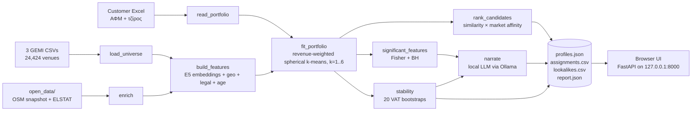

# ForceCRM Architecture

How the app turns a customer list (ΑΦΜ + revenue) into customer profiles (ICPs), Greek descriptions and ranked lookalike prospects. It also covers whether the results are deterministic.

## 1. Overview



Everything runs on the laptop. The only AI components are:
- **multilingual-e5-small** (sentence-transformers), which embeds Greek activity (ΚΑΔ) descriptions
- **Ministral 3 3B** (Ollama), which writes the profile descriptions

No external AI service is called at runtime.

| File | Responsibility |
|---|---|
| `run.py` | One-command bootstrap: venv, dependencies, model download, starts Ollama and the server |
| `forcecrm/data.py` | Loads and validates the CSVs and the uploaded Excel; normalises ΑΦΜ |
| `forcecrm/enrichment.py` | Offline OpenStreetMap venue matching and ELSTAT tourism bands (extra points X2/X3) |
| `forcecrm/features.py` | Builds the business vector (A1) and the trait sets used for statistics |
| `forcecrm/clustering.py` | Profile discovery (A2) and bootstrap stability (A5) |
| `forcecrm/evidence.py` | Statistical over-representation tests (A4) |
| `forcecrm/narrative.py` | Grounded Greek descriptions (A6) |
| `forcecrm/affinity.py` | Shrunken market-concentration signal used in ranking (A7) |
| `forcecrm/pipeline.py` | Orchestrates everything, builds the exports, runs the internal holdout test |
| `forcecrm/server.py` + `web/` | FastAPI backend and plain-JS UI (A8) |
| `scripts/` | CLI analysis, export validator, benchmarks, model-card builder |

## 2. Pipeline, step by step

### 2.1 Load and validate (`data.py`)
- Reads the three `;`-separated CSVs (UTF-8 BOM, decimal comma, `NULL` as empty). It checks required columns and duplicate IDs, normalises ΑΦΜ to 9 digits, and sorts venues by `company_id`.
- Activity types are mapped to `primary`, `secondary` or `auxiliary`.
- The Excel is read with Greek or English column aliases (`ΑΦΜ`/`VAT`, `Τζίρος (€)`/`revenue`). It is rejected if any ΑΦΜ is unknown, duplicated, or there are fewer than 5 customers. The portfolio is **sorted by ΑΦΜ**, so the row order of the Excel never matters.

### 2.2 Enrichment (`enrichment.py`, offline)
- **OpenStreetMap linkage:** each venue is matched to a food POI from a bundled Geofabrik snapshot. The search radius is 120 m (BallTree), and a match needs:
  - trade-name similarity ≥ 0.85
  - a combined score ≥ 0.80
  - a clear margin over the runner-up

  Ambiguous or shared POIs are marked, not guessed.
- **Tourism context:** ELSTAT 2024 hotel nights ÷ 2021 residents per municipality, binned into `<1`, `1–<10` and `≥10` nights per resident.

### 2.3 Business representation (`features.py`, requirement A1)
Each venue becomes one L2-normalised vector made of four weighted blocks:

| Block | Weight¹ | Content |
|---|---:|---|
| Activity | 0.65 | E5 embedding of the **primary** ΚΑΔ description (85%). The secondary part (15%) uses up to 3 secondary ΚΑΔ 56xx codes that are semantically close to the primary one (cosine ≥ 0.70). Unrelated secondary codes and all auxiliary codes are ignored, which handles self-declared noise. Averaging means businesses with many ΚΑΔ are not penalised (A3). |
| Geography | 0.20 | GPS radial-basis features over 20 fixed anchors across Greece (70%), prefecture one-hot (30%), and a missing-GPS flag |
| Legal form | 0.10 | One-hot (ΑΤΟΜΙΚΗ, ΙΚΕ, ΟΕ, …) |
| Age | 0.05 | Soft bins at 2/4/6/8 years, measured from a **fixed** reference date `AS_OF = 2026-11-01` |

¹ Share of the squared norm. Each block is scaled by √weight before the final normalisation.

Embeddings are computed once per exact model and text fingerprint, then cached in `.cache/embeddings-<sha256>.npy`.

The same step builds a **trait set** per venue for the statistics: legal form, prefecture, municipality, branch flag, incorporation year and primary ΚΑΔ. The tourism band and the OSM amenity are added later.

### 2.4 Profile discovery (`clustering.py` + `pipeline.fit_portfolio`, A2/A3)
- **Revenue use:** each customer's weight is √(revenue, capped at the 95th percentile). It is normalised, then split evenly across that ΑΦΜ's branches. Big accounts therefore matter more, but one large account cannot dominate.
- **Algorithm:** revenue-weighted **spherical k-means** (cosine), with 6 seeded restarts (k-means++ style), for every k from 1 to 6.
- **Choosing k:** the best `silhouette − 0.025·(k−1)` among solutions where every profile has ≥ 5 distinct ΑΦΜ. It must also beat a threshold of 0.18; otherwise the answer is "one ICP".
- **Assignment uses the same metric:** every venue in the universe gets its cosine distance to the nearest profile centre. The acceptance radius is the profile's 95th-percentile member distance + 0.015. Venues outside it are assigned `NONE` ("fits no profile"). The `score` in `assignments.csv` is 1 − distance.

### 2.5 Statistical evidence (`evidence.py`, A4)
- For every profile × trait, a one-sided Fisher exact test is run at **ΑΦΜ level**, so branches cannot multiply the evidence.
- A **global Benjamini–Hochberg** correction is applied across all tests.
- A trait is reported only if q ≤ 0.05, it has ≥ 5 supporting ΑΦΜ, and lift ≥ 1.2. This stops rare traits passing by chance.
- These are exploratory statistics: the same data both forms the clusters and is tested.
- **Portfolio-wide business traits** (`portfolio_traits`): the same test, run on all customers against the universe, restricted to activity, legal form, incorporation year, branch flag and OSM amenity. This surfaces business traits that customers share *across* regions, which per-profile tests cannot see. On the supplied portfolio, two pass: ΙΚΕ (110/300, 2.4×) and school canteens (19/300, 2.4×, q = 0.02). They are stored in `report.json` and shown above the profiles in the UI.
- **Activity mix per profile** (`activity_mix`): the profile's three most common primary activities, with ΑΦΜ shares against the market. This is descriptive, not a test. It goes into `profiles.json`, the UI and the description.

### 2.6 Stability (`clustering.stability`, A5)
- 20 bootstrap resamples of the customer ΑΦΜ. Each resample is re-clustered with the same k, and the profiles are matched to the originals (Hungarian algorithm).
- **Per profile:** mean and 10th-percentile Jaccard overlap of the member ΑΦΜ.
- **Globally:** the adjusted Rand index.

### 2.7 Greek descriptions (`narrative.py`, A6)
1. Each fact is written as a correct Greek **template sentence**. The facts are size, revenue share and up to 4 defining traits, selected so the same place is not stated twice and the strongest activity or legal-form trait is always included.
2. Ministral rewrites **one sentence at a time**: chat API, fixed system prompt, 5 fictional few-shot examples, JSON schema, temperature 0, seed 42, top-k 1.
3. Every rewrite goes through **deterministic checks**:
   - numbers and percentages must come from the source fact
   - the defining count must be kept
   - place, activity and legal-form names must be kept
   - known misleading words and grammar slips are rejected
   - duplicate sentences are rejected
4. A sentence that fails twice keeps its template wording. Each claim records `author` (`local LLM` or `computed template`) and its source field.
5. A **computed** sentence states the profile's most common primary activities against the market.
6. A **computed** final sentence states profile quality, bootstrap stability (mean and p10) and fit confidence. It says explicitly that this is not a purchase probability.

The descriptions carry an AI label in the UI and in `profiles.json`. Profile titles are built deterministically from the top traits. **The LLM never influences scores, profiles or rankings.**

### 2.8 Lookalike ranking (`pipeline.rank_candidates` + `affinity.py`, A7)
For every venue whose ΑΦΜ is **not** a customer:

```
score = similarity_to_nearest_profile × sigmoid(market_affinity)
```

- `similarity_to_nearest_profile` = 1 − cosine distance, the same metric used for clustering and assignment.
- `market_affinity` is a weighted sum of **shrunken log-lifts**. Each one measures how concentrated customers are in the venue's group, compared with the universe. The groups and their weights are:
  - municipality 0.27
  - prefecture × activity 0.22
  - prefecture 0.20
  - primary activity 0.15
  - tourism band 0.10
  - legal form 0.08
  - incorporation year 0.08

  Each lift adds 5 "prior customer equivalents", so tiny groups stay close to neutral.
- One best venue is kept per ΑΦΜ. Ties are broken by `company_id`, so the order is stable.
- All ~23,600 non-customer ΑΦΜ are ranked, well above the 2,000 the brief requires.
- **Justification:** the profile's significant traits that the venue shares, plus its similarity and concentration figures. Venues outside the acceptance radius are prefixed "Διερευνητική πρόταση".

### 2.9 Outputs and internal evaluation
- `profiles.json`: title, AI description with per-sentence claims, customer and venue counts, revenue share, stability, confidence, traits with lift, p-value and q-value, `activity_mix`, plus LLM parameters.
- `assignments.csv` (`company_id, profile_id, score`) and `lookalikes.csv` (`profile_id, company_id, rank, score, rationale`).
- `report.json`: data audit, chosen k and diagnostics, `portfolio_traits`, input SHA-256 hashes, timings and the internal holdout test.
- **Holdout test** (seed 2026): 20% of customer ΑΦΜ are hidden, the model refits, and Recall@500/2000 is compared with the brief's primary-ΚΑΔ baseline. Current result: 25% / 55%, against a baseline of 1.7% / 8.3%. Across 5 seeded splits (`scripts.audit_ranking --with-tourism`) the mean is 21.3% / 51.3%.

### 2.10 Web app (`server.py`, A8)
- FastAPI bound to `127.0.0.1`, with a middleware that rejects cross-site requests.
- `POST /api/analyze` starts the pipeline in a background thread, and the UI polls `/api/jobs/{id}` for progress.
- Each job writes to `outputs/<job_id>/`. The files can be downloaded through `/api/jobs/{id}/export/{file}`, and the latest completed run is restored on startup.
- A **demo mode** uses a synthetic portfolio, lexical TF-IDF instead of E5, and no LLM. It is clearly labelled and not valid for submission.

## 3. Why the profiles are mostly geographic

On the supplied portfolio the three profiles are effectively regions: tourist islands, Kassandra plus Thessaloniki, and Attica. This is a property of the data, not a weighting bug:

- Every business is food service (ΚΑΔ 56), so activity embeddings are nearly identical. The mean cosine similarity between two random venues is **0.91** for activity, against **0.33** for geography. Activity carries 65% of the weight but only **8%** of the separation between profile centres; geography gives **78%**.
- The customers' activity mix is close to the market's. For example, cafeterias are 13.7% of customers vs 12.6% of all businesses, and full-service restaurants 13.7% vs 10.9%.

`scripts/experiment_representation.py` tests the obvious fixes, using the 5-split holdout with the tourism signal:

| Variant | Recall@500 | Recall@2000 | k | Activity / geography share of separation |
|---|---:|---:|---:|---|
| **Shipped** | **21.3%** | **51.3%** | 3 | 8% / 78% |
| Activity embeddings centred (market mean removed) | 18.0% | 44.7% | 2 | 81% / 8% |
| Finer geography (≈35 km grid, σ 25 km, municipality one-hot) | 18.7% | 51.3% | 2 | 14% / 25% (legal form 60%) |
| Both | 17.0% | 40.3% | 2 | 83% / 6% |

A `--sweep` over partial centring (α = 0.5 / 0.8) and lower activity weights (0.45 / 0.30) found no setting better on both cutoffs. The best Recall@2000 was 54.0%, with α = 0.5, but it had 19.3% at 500 and merged the profiles to k = 2. With 60 held-out customers per split, differences of 2–3 points are within noise. In every variant, the traits that pass the statistical tests were still mostly geographic.

**Decision:** keep the shipped representation and report business traits explicitly instead: portfolio-wide traits, the activity mix per profile, and the activity sentence in each description. A salesperson sees that this customer base is defined by *where* businesses are, and also that ΙΚΕ companies and school canteens are over-represented everywhere.

## 4. Is it deterministic?

**For recommendations, yes.** The same Excel, data files, model files and software versions give the **same profiles, the same assignments and the same ranked lookalikes**, down to the byte.

**Verified on 2026-11-07:** two independent full runs on the same Mac produced byte-identical `lookalikes.csv`, `assignments.csv` and `enrichment.csv`, and identical profiles, traits, stability and confidence values. An earlier run on the original author's Windows laptop reported the same for a repeated web run.

### Why
| Source of possible randomness | How it is controlled |
|---|---|
| k-means initialisation | `numpy` generator with fixed seed 42, 6 fixed restarts, best loss kept |
| Silhouette sampling | `random_state=42` |
| Bootstrap stability | Fixed seeds (123, and 500 + b per resample). It affects only the reported stability, never the ranking |
| Holdout split | Fixed seed 2026. It affects only the reported recall |
| Excel row order | Portfolio sorted by ΑΦΜ; venues sorted by `company_id` |
| Ties in the ranking | Sorted by `(score desc, company_id asc)`, one venue per ΑΦΜ |
| Business age drifting with the calendar | Age measured from the fixed `AS_OF = 2026-11-01`, not "today" |
| Embeddings | Same local model files, CPU inference, cached per model/text fingerprint |
| Thread-count effects in linear algebra | BLAS limited to 2 threads (`threadpool_limits`); torch to ≤ 4 threads |
| The LLM | **Not used in ranking at all.** It only writes the description text |

### What changes the recommendations (by design)
- **Any change to the customer list.** Adding or removing a customer, or changing a revenue figure, refits the profiles and the concentration signal, so ranks can shift. This is intended: the recommendations describe *this* portfolio.
- A different data extract, a different embedding model, or a code change to the weights and thresholds.

### Where small differences are possible
- **Different hardware, OS or library versions** can change floating-point results in the embeddings or matrix maths in the last decimal places. That can swap two candidates whose scores are almost tied. Pinned package versions (`requirements*.txt`) and the embedding cache keep this rare. The aggregate results (profiles, recall) should not change.
- **Descriptions only:** temperature 0, seed 42 and top-k 1 make the text repeatable on the same machine with the same Ollama and model digest. Across machines, GPU/CPU kernels can produce different wording. Every number in the text is still checked against the data, so wording may vary but facts cannot. `profiles.json` records the model digest, prompt hash and rejected drafts for auditing.

### How to check it yourself
Run the analysis twice and compare the files:

```bash
.venv/bin/python -m scripts.analyze --portfolio ForceCRM_Hackathon_Pelatologio.xlsx --output outputs/run-a
.venv/bin/python -m scripts.analyze --portfolio ForceCRM_Hackathon_Pelatologio.xlsx --output outputs/run-b
shasum -a 256 outputs/run-a/lookalikes.csv outputs/run-b/lookalikes.csv
```

`report.json` also stores SHA-256 hashes of the three input CSVs and the portfolio, so you can confirm two runs used the same inputs.
