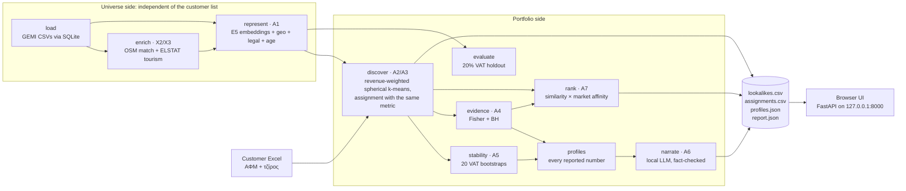

# ForceCRM Architecture

How the app turns a customer list (ΑΦΜ + revenue) into customer profiles (ICPs), Greek descriptions and ranked lookalike prospects. It also covers whether the results are deterministic.

## 1. Overview

The analysis is a chain of **named stages** (`forcecrm/stages/`), one per requirement of the brief:



Ranking reads only the statistical traits, never the AI text, so it is computed **before** the LLM runs. `narrate` is the only stage whose output is not bit-reproducible across machines (§4). How stages are run and cached is in §2.0.

Everything runs on the laptop. The only AI components are:
- **multilingual-e5-small** (sentence-transformers), which embeds Greek activity (ΚΑΔ) descriptions
- **Ministral 3 3B** (Ollama), which writes the profile descriptions

No external AI service is called at runtime. The only outbound call is an **opt-in** ΓΕΜΗ Open Data status check of top prospects (§2.11). It is data, not AI, and is off by default.

| File | Responsibility |
|---|---|
| `run.py` | One-command bootstrap: venv, dependencies, model download, starts Ollama and the server |
| `forcecrm/data.py` | Loads and validates the GEMI universe and the uploaded Excel; normalises ΑΦΜ |
| `forcecrm/db.py` | Embedded SQLite store (`.cache/forcecrm.sqlite`): imported universe, analysis runs, ΓΕΜΗ statuses, users table for T1 (§2.12) |
| `forcecrm/enrichment.py` | Offline OpenStreetMap venue matching and ELSTAT tourism bands (extra points X2/X3) |
| `forcecrm/features.py` | Builds the business vector (A1) and the trait sets used for statistics |
| `forcecrm/clustering.py` | Profile discovery (A2) and bootstrap stability (A5) |
| `forcecrm/evidence.py` | Statistical over-representation tests (A4) |
| `forcecrm/narrative.py` | Grounded Greek descriptions (A6) |
| `forcecrm/titles.py` | Grounded profile titles: the LLM picks from data-backed phrases (A6) |
| `forcecrm/live.py` | Opt-in live ΓΕΜΗ Open Data status check of top prospects |
| `forcecrm/affinity.py` | Shrunken market-concentration signal used in ranking (A7) |
| `forcecrm/stages/` | The stage graph (`definitions.py`) and the small runner that resolves, caches and times stages (`engine.py`) (§2.0) |
| `forcecrm/pipeline.py` | Profile fitting, ranking and holdout functions; `run_analysis` resolves the stages and assembles `report.json`; `export_result` writes the files |
| `forcecrm/server.py` + `web/` | FastAPI backend and plain-JS UI (A8) |
| `scripts/` | CLI analysis, export validator, benchmarks, model-card builder |

## 2. Pipeline, step by step

### 2.0 Stages, cache keys and re-runs (`forcecrm/stages/`)
Each stage is a function of the artifacts of the stages it needs and of the run parameters it declares. Nothing is changed in place: for example `enrich` returns a new companies table carrying the tourism band instead of adding a column to the shared one.

| Stage | Requirement | Needs | Parameters in its key |
|---|---|---|---|
| `load` | data | none | CSV SHA-256, library versions, `prefilter` |
| `enrich` | X2/X3 | load | + open-data snapshot SHA-256 |
| `represent` | A1 | load, enrich | weights, demo, embedding-model files, library versions |
| `discover` | A2/A3 | enrich, represent | portfolio SHA-256 |
| `stability` | A5 | represent, discover | bootstrap count |
| `evidence` | A4 | load, enrich, represent, discover | portfolio SHA-256 |
| `profiles` | A2–A5 | the six above | portfolio SHA-256 |
| `rank` | A7 | load, enrich, represent, discover, evidence | portfolio SHA-256, `postfilter` |
| `narrate` | A6 | profiles | LLM name (+ model digest per profile) |
| `evaluate` | holdout | load, enrich, represent | portfolio SHA-256, `postfilter` |

**Cache key (Merkle style):** `sha256(stage name, SHA-256 of the stage's source files, its parameter values, the keys of the stages it needs)`. A key changes exactly when something the stage can see changes: input data, a parameter, or the code. Only the root inputs are hashed (CSVs, portfolio, open-data snapshot, embedding-model file list); large arrays never are.

**Storage:** `.cache/stages/<stage>-<key>.pkl` (gitignored), written atomically. Only this module writes or reads these files, on the local machine, and only the 4 most recent artifacts per stage are kept. `narrate` is cached **per profile** in `.cache/stages/narrate-<key>.json`, keyed on that profile's facts, the model name and its Ollama digest, so unchanged profiles keep their text and re-pulling a model invalidates it.

**What re-runs:**
- Same inputs: every stage comes from the cache.
- New customer list: `load`, `enrich` and `represent` are reused.
- Custom weights: `load` and `enrich` are reused; the default-weights comparison in `evaluate` reuses the cached default `represent`.
- Text only (prompt, model or `narrative.py` changed): only `narrate` runs.
- Data filters "after the analysis": only `rank` and `evaluate` run (under a second). "Before the analysis": everything runs, because the universe itself changes.
- No filters: `prefilter` and `postfilter` are `null`, and the exports are byte-identical to a run without the filter feature (checked on 2026-11-08 against `main` 99f24d1).

`report.json` records each stage's key prefix, status (`computed`, `cached`, or `partial` when some profiles' text was reused) and seconds under `stages`.

**CLI:** `scripts.analyze --until-stage <stage>` stops after that stage and prints the stage log. `--from-stage <stage>` recomputes that stage and every stage downstream of it, ignoring cached artifacts; `--from-stage narrate` regenerates the text. `--no-cache` keeps everything in memory.

### 2.1 Load and validate (`data.py`)
- The universe is read through the embedded SQLite store (§2.12). It imports the CSVs once and re-imports only when their SHA-256 changes; `FORCECRM_DB=0` reads the CSVs directly. Both paths return identical frames (tested).
- Reads the three `;`-separated CSVs (UTF-8 BOM, decimal comma, `NULL` as empty). It checks required columns and duplicate IDs, normalises ΑΦΜ to 9 digits, and sorts venues by `company_id`.
- Activity types are mapped to `primary`, `secondary` or `auxiliary`.
- The Excel is read with Greek or English column aliases (`ΑΦΜ`/`VAT`, `Τζίρος (€)`/`revenue`). It is rejected if any ΑΦΜ is unknown, duplicated, or there are fewer than 5 customers. The portfolio is **sorted by ΑΦΜ**, so the row order of the Excel never matters.

### 2.2 Enrichment (`enrichment.py`, offline)
- **OpenStreetMap linkage:** each venue is matched to a food POI from a bundled Geofabrik snapshot. The search radius is 120 m (BallTree), and a match needs:
  - trade-name similarity ≥ 0.85
  - a combined score ≥ 0.80
  - a clear margin over the runner-up

  Ambiguous or shared POIs are marked, not guessed.
- **Tourism context:** ELSTAT 2024 hotel nights ÷ 2021 residents per municipality, binned into `<1`, `1–<10` and `≥10` nights per resident.

### 2.3 Business representation (`features.py`, requirement A1)
Each venue becomes one L2-normalised vector made of four weighted blocks:

| Block | Weight¹ | Content |
|---|---:|---|
| Activity | 0.65 | E5 embedding of the **primary** ΚΑΔ description (≥ 80%), plus related secondaries: up to 3 ΚΑΔ 56 codes (≤ 15%) and up to 3 outside food service (≤ 5%), each with cosine ≥ 0.70 to the primary. The secondary share shrinks as 5/n above 5 declared secondaries and is zero above 20 (see *Secondary activities* below). Auxiliary codes are ignored. Averaging means businesses with many ΚΑΔ are not penalised (A3). |
| Geography | 0.20 | GPS radial-basis features over 20 fixed anchors across Greece (70%), prefecture one-hot (30%), and a missing-GPS flag |
| Legal form | 0.10 | One-hot (ΑΤΟΜΙΚΗ, ΙΚΕ, ΟΕ, …) |
| Age | 0.05 | Soft bins at 2/4/6/8 years, measured from a **fixed** reference date `AS_OF = 2026-11-01` |

¹ Share of the squared norm. Each block is scaled by √weight before the final normalisation.

**Secondary activities (challenge owner's guidance).** Every business has one primary activity and usually several secondaries (median 3; 13% declare more than 10, max 238). Following the challenge owner's guidance (primary dominates, secondaries take part, very many secondaries are usually noise):
  - The primary ΚΑΔ gets at least 80% of the activity vector.
  - Up to 3 related secondary ΚΑΔ 56 codes share up to 15%, and up to 3 related secondaries outside food service (bakery, retail, lodging…) share up to 5%. *Related* means cosine ≥ 0.70 to the primary.
  - Trust in secondaries falls as 5/n once a business declares n > 5 of them, and is zero above 20. Such a business falls back to its primary activity.
  - The business itself is never penalised (A3): only its secondaries count less.
  - Measured on 5 holdout splits: recall-neutral against the old 85/15 rule (21.7% / 51.0% vs 21.3% / 51.3%), with clearly more stable profiles. Worst-10% bootstrap stability rose from 50% to 90% for the Kassandra profile.

  | Rule (5 seeded splits, tourism on) | Recall@500 | Recall@2000 |
  |---|---:|---:|
  | Old: 85/15, ≤ 3 related ΚΑΔ 56 | 21.3% | 51.3% |
  | Trust falls after 5, none above 20 | 21.3% | 51.0% |
  | Trust falls after 10, none above 30 | 21.3% | 51.3% |
  | **Shipped: falls after 5, none above 20, + related non-56 at 5%** | **21.7%** | **51.0%** |
  | Number of secondaries as a ranking signal (3 variants) | 19.3–20.3% | 52.3–52.7% |

  The count signal was not adopted: it trades Recall@500 for Recall@2000. As a portfolio-wide trait, customers more often declare more than 20 secondaries (8.0% vs 4.5%, 1.8×, p = 0.004) but also none (18.7% vs 14.9%); neither passes the Benjamini–Hochberg correction, so neither is shown.

Embeddings are computed once per exact model and text fingerprint, then cached in `.cache/embeddings-<sha256>.npy`.

The same step builds a **trait set** per venue for the statistics: legal form, prefecture, municipality, branch flag, incorporation year and primary ΚΑΔ. The tourism band and the OSM amenity are added later.

### 2.4 Profile discovery (`clustering.py` + `pipeline.fit_portfolio`, A2/A3)
- **Revenue use:** each customer's weight is √(revenue, capped at the 95th percentile). It is normalised, then split evenly across that ΑΦΜ's branches. Big accounts therefore matter more, but one large account cannot dominate.
- **Algorithm:** revenue-weighted **spherical k-means** (cosine), with 6 seeded restarts (k-means++ style), for every k from 1 to 6.
- **Choosing k:** the best `silhouette − 0.025·(k−1)` among solutions where every profile has ≥ 5 distinct ΑΦΜ. It must also beat a threshold of 0.18; otherwise the answer is "one ICP".
- **Assignment uses the same metric:** every venue in the universe gets its cosine distance to the nearest profile centre. The acceptance radius is the profile's 95th-percentile member distance + 0.015. Venues outside it are assigned `NONE` ("fits no profile"). The `score` in `assignments.csv` is 1 − distance.

### 2.5 Statistical evidence (`evidence.py`, A4)
- For every profile × trait, a one-sided Fisher exact test is run at **ΑΦΜ level**, so branches cannot multiply the evidence.
- A **global Benjamini–Hochberg** correction is applied across all tests.
- A trait is reported only if q ≤ 0.05, it has ≥ 5 supporting ΑΦΜ, and lift ≥ 1.2. This stops rare traits passing by chance.
- These are exploratory statistics: the same data both forms the clusters and is tested.
- **Portfolio-wide business traits** (`portfolio_traits`): the same test, run on all customers against the universe, restricted to activity, legal form, incorporation year, branch flag and OSM amenity. This surfaces business traits that customers share *across* regions, which per-profile tests cannot see. On the supplied portfolio, two pass: ΙΚΕ (110/300, 2.4×) and school canteens (19/300, 2.4×, q = 0.02). They are stored in `report.json` and shown above the profiles in the UI.
- **Activity mix per profile** (`activity_mix`): the profile's three most common primary activities, with ΑΦΜ shares against the market. This is descriptive, not a test. It goes into `profiles.json`, the UI and the description.

### 2.6 Stability (`clustering.stability`, A5)
- 20 bootstrap resamples of the customer ΑΦΜ. Each resample is re-clustered with the same k, and the profiles are matched to the originals (Hungarian algorithm).
- **Per profile:** mean and 10th-percentile Jaccard overlap of the member ΑΦΜ.
- **Globally:** the adjusted Rand index.

### 2.7 Greek descriptions (`narrative.py`, A6)
1. Each fact is written as a correct Greek **template sentence**. The facts are size, revenue share and up to 4 defining traits, selected so the same place is not stated twice and the strongest activity or legal-form trait is always included.
2. Ministral rewrites **one sentence at a time**: chat API, fixed system prompt, 5 fictional few-shot examples, JSON schema, temperature 0, seed 42, top-k 1.
3. Every rewrite goes through **deterministic checks**:
   - numbers and percentages must come from the source fact
   - the defining count must be kept
   - place, activity and legal-form names must be kept
   - known misleading words and grammar slips are rejected
   - duplicate sentences are rejected
4. A sentence that fails twice keeps its template wording. Each claim records `author` (`local LLM` or `computed template`) and its source field.
5. A **computed** sentence states the profile's most common primary activities against the market.
6. A **computed** final sentence states profile quality, bootstrap stability (mean and p10) and fit confidence. It says explicitly that this is not a purchase probability.

The descriptions carry an AI label in the UI and in `profiles.json`. **Titles** (`titles.py`) are also grounded:
- Candidate phrases come from significant place and legal-form traits (lift ≥ 1.5, ≥ 15% of the profile) and from the profile's **activity families**. These are ΚΑΔ codes grouped into names a salesperson recognises, e.g. καφετέριες, εστιατόρια/ταβέρνες, κυλικεία/καντίνες, each covering ≥ 15% of the profile. They are stored as `activity_families`, separate from the per-ΚΑΔ `activity_mix`.
- The LLM only **picks** from these phrases, through an enum-constrained JSON schema. The widest-coverage place always leads.
- An invalid choice falls back to a fixed rule. `title_source` records `ai` or `template-fallback`. **The LLM never influences scores, profiles or rankings.**

### 2.8 Lookalike ranking (`pipeline.rank_candidates` + `affinity.py`, A7)
For every venue whose ΑΦΜ is **not** a customer:

```
score = similarity_to_nearest_profile × sigmoid(market_affinity)
```

- `similarity_to_nearest_profile` = 1 − cosine distance, the same metric used for clustering and assignment.
- `market_affinity` is a weighted sum of **shrunken log-lifts**. Each one measures how concentrated customers are in the venue's group, compared with the universe. The groups and their weights are:
  - municipality 0.27
  - prefecture × activity 0.22
  - prefecture 0.20
  - primary activity 0.15
  - tourism band 0.10
  - legal form 0.08
  - incorporation year 0.08

  Each lift adds 5 "prior customer equivalents", so tiny groups stay close to neutral.
- One best venue is kept per ΑΦΜ. Ties are broken by `company_id`, so the order is stable.
- All ~23,600 non-customer ΑΦΜ are ranked, well above the 2,000 the brief requires.
- **Justification** (`rationale`, plain Greek): up to 3 of the profile's significant traits that the venue shares, using the short names from the titles, then its similarity and customer-concentration figures with Greek decimal commas. Venues outside the acceptance radius are prefixed «Διερευνητική πρόταση».
- **Per-profile rank (A7):** the export keeps one global rank. The UI also shows each prospect's position within its nearest profile («#3 στο ICP-02»).

### 2.9 Outputs and internal evaluation
- `profiles.json`: title, `confidence` (the brief's name; same value as `confidence_score`), AI description with per-sentence claims, customer and venue counts, revenue share, stability, confidence, traits with lift, p-value and q-value, `activity_mix`, plus LLM parameters.
- `assignments.csv` (`company_id, profile_id, score`) and `lookalikes.csv` (`profile_id, company_id, rank, score, rationale`).
- `clusters.xlsx` / `clusters.json` / `clusters.csv` (`forcecrm/clusters.py`): each profile with its description and the ΑΦΜ it contains. Recommended prospects come from `lookalikes.csv` and are ranked within the profile; *within profile* means the same acceptance radius as `assignments.csv`, otherwise exploratory. The profile's customers are listed one row per ΑΦΜ.
- `report.json`: data audit, chosen k and diagnostics, `portfolio_traits`, input SHA-256 hashes, timings and the internal holdout test.
- **Holdout test** (seed 2026): 20% of customer ΑΦΜ are hidden, the model refits, and Recall@500/2000 is compared with the brief's primary-ΚΑΔ baseline. Current result: 25% / 55%, against a baseline of 1.7% / 8.3%. Across 5 seeded splits (`scripts.audit_ranking --with-tourism`) the mean is 21.7% / 51.0%.

### 2.10 Web app (`server.py`, A8)
- **Περισσότερες επιλογές** panel:
  - **Adjustable similarity weights.** They are passed to `build_features`; the validated defaults are 65 / 20 / 10 / 5. A custom run is flagged in `report.json` (`custom_weights`) and re-runs the holdout with the defaults for comparison.
  - **Data filters** (`filters.py`). Exclude activities (ΚΑΔ, exact codes or a code prefix such as `5630` for the whole family; primary ΚΑΔ only, or any declared ΚΑΔ) and places (Περιφερειακή Ενότητα, Δήμος). Exclusion is per venue. A switch chooses when it applies:
    - **After the analysis** (`post`, default): profiles, statistics and assignments are unchanged. `rank_candidates` skips excluded venues *before* keeping one venue per VAT, so a business can still appear through a non-excluded branch, and ranks run 1..n. The holdout filters both the model and the baseline lists in the same way, and measures recall over the held-out customers that still have an eligible venue (`held_out_excluded` counts the rest).
    - **Before the analysis** (`pre`, raw data): `load` drops the excluded venues and their activity rows, so features, profiles, base rates, statistics, ranking and holdout are all computed on the filtered market. Customers keep only their non-excluded venues; a customer with none left leaves the portfolio (`dropped_customers`), and at least 5 must remain.
    - `GET /api/filters/options` lists the activities and places with venue counts; `POST /api/filters/preview` returns how many venues and businesses a set of filters excludes. `report.json` records the filters, counts and a Greek summary under `filters`, and adds a warning. `scripts.validate_exports` accepts a filtered run and checks it, but submission exports must come from an unfiltered run (a `pre` run's `assignments.csv` omits the excluded venues).
  - **Live ΓΕΜΗ check** (§2.11).
- The prospects map is drawn over an offline Natural Earth outline of Greece.
- FastAPI bound to `127.0.0.1`, with a middleware that rejects cross-site requests.
- `POST /api/analyze` starts the pipeline in a background thread, and the UI polls `/api/jobs/{id}` for progress.
- Each job writes to `outputs/<job_id>/` and is stored in SQLite (§2.12). The files can be downloaded through `/api/jobs/{id}/export/{file}`, and the latest completed run is restored on startup (export folders not yet in the database, e.g. CLI runs, are imported once).
- The job response carries the profiles, the report and only the top 2,000 map points (~0.4 MB instead of the full 11 MB list). The prospects table pages through `/api/runs/{id}/lookalikes`, with profile, search and ΓΕΜΗ-status filters applied in SQL.
- A **demo mode** uses a synthetic portfolio, lexical TF-IDF instead of E5, and no LLM. It is clearly labelled and not valid for submission.

### 2.11 Optional live ΓΕΜΗ status check (`live.py`)
After an analysis, the user can check whether the top N prospects (≤ 200) are still active in the ΓΕΜΗ Open Data API, using their own `api_key`.
- **Data sent:** only prospect ΑΦΜ.
- **Limits:** 8 requests per minute by default, with back-off on 429/5xx. Results are cached for 7 days in the SQLite `gemi_status` table (an older `.cache/gemi-status.json` is migrated once).
- **Output:** `live-status.csv`, with ODC-BY attribution.
- It runs in its own thread, can be stopped, and **never changes profiles, scores or ranking**.

### 2.12 Embedded data store (`db.py`, SQLite)
"Serverless" in the literal sense: one file, `.cache/forcecrm.sqlite` (gitignored), the standard-library `sqlite3` driver, no daemon, nothing to install. It keeps the one-command setup.

| Table | Contents |
|---|---|
| `companies`, `activities`, `activity_descriptions` | The three GEMI CSVs, stored exactly as pandas parses them (text columns, original row order). Indexed by `company_id`, `vat`, municipality and activity |
| `meta` | CSV SHA-256 hashes, column order, import time |
| `runs` | One row per analysis: parameters (demo, weights), portfolio hash, input hashes, full `report.json` |
| `profiles`, `profile_traits` | Profiles (full JSON plus key columns) and their significant traits (lift, p, q) |
| `assignments`, `lookalikes` | Per-run venue assignments and ranked prospects, with display fields and a folded search key; indexed by run + rank and run + profile + rank |
| `gemi_status` | Live ΓΕΜΗ results (7-day cache), joined into prospect queries for the status filters |
| `users`, `sessions`, `support_tickets` | Local demo login (`auth.py`): scrypt password hashes, hashed session tokens with 7-day expiry, tutorial state, and help-chat hand-off tickets |

- **Import:** on first use, and whenever a CSV's SHA-256 changes, inside one transaction (`BEGIN IMMEDIATE`, so concurrent server threads cannot import twice). Measured on the full data: cold import 1.5 s, warm load 0.6 s (direct CSV read: 0.5 s); file size 20 MB.
- **Why rows are stored raw:** `data.load_universe` applies the same normalisation (ΑΦΜ padding, decimal commas, sorting) on top of either source, so the analysis sees identical frames. The exports are unchanged: `lookalikes.csv`, `assignments.csv` and `enrichment.csv` are byte-identical before and after; `profiles.json` differs only in the measured `llm.seconds`, which varies on every run.
- **Search:** SQLite's `lower()` is ASCII-only, so a registered `fold()` function (casefold + strip accents) builds the search key; "ταβερνα" finds "Ταβέρνα".
- **API:** `GET /api/runs`, `GET /api/runs/{id}/lookalikes?profile=&q=&live=&offset=&limit=` (limit ≤ 200), `GET /api/companies?q=`, `GET /api/companies/{company_id}` (venue, ΚΑΔ with descriptions, stored ΓΕΜΗ status).
- **The files stay the deliverable.** The graded exports are still written by `export_result`; the database adds querying, history and caching on top and never replaces them.

## 3. Why the profiles are mostly geographic

On the supplied portfolio the three profiles are effectively regions: tourist islands, Kassandra plus Thessaloniki, and Attica. This is a property of the data, not a weighting bug:

- Every business is food service (ΚΑΔ 56), so activity embeddings are nearly identical. The mean cosine similarity between two random venues is **0.91** for activity, against **0.33** for geography. Activity carries 65% of the weight but only **8%** of the separation between profile centres; geography gives **78%**.
- The customers' activity mix is close to the market's. For example, cafeterias are 13.7% of customers vs 12.6% of all businesses, and full-service restaurants 13.7% vs 10.9%.

`scripts/experiment_representation.py` tests the obvious fixes, using the 5-split holdout with the tourism signal:

| Variant | Recall@500 | Recall@2000 | k | Activity / geography share of separation |
|---|---:|---:|---:|---|
| **Shipped at the time** (old secondary rule) | **21.3%** | **51.3%** | 3 | 8% / 78% |
| Activity embeddings centred (market mean removed) | 18.0% | 44.7% | 2 | 81% / 8% |
| Finer geography (≈35 km grid, σ 25 km, municipality one-hot) | 18.7% | 51.3% | 2 | 14% / 25% (legal form 60%) |
| Both | 17.0% | 40.3% | 2 | 83% / 6% |

A `--sweep` over partial centring (α = 0.5 / 0.8) and lower activity weights (0.45 / 0.30) found no setting better on both cutoffs. The best Recall@2000 was 54.0%, with α = 0.5, but it had 19.3% at 500 and merged the profiles to k = 2. With 60 held-out customers per split, differences of 2–3 points are within noise. In every variant, the traits that pass the statistical tests were still mostly geographic.

**Decision:** keep the shipped representation and report business traits explicitly instead: portfolio-wide traits, the activity mix per profile, and the activity sentence in each description. A salesperson sees that this customer base is defined by *where* businesses are, and also that ΙΚΕ companies and school canteens are over-represented everywhere.

**Follow-up (2026-11-08): ΚΑΔ co-declaration.** The description embeddings cannot separate food-service types well, so a second experiment (`scripts/experiment_codeclaration.py`) learns code vectors from which ΚΑΔ businesses declare *together*: PPMI over primary + secondary codes, then 64-dimensional SVD. Measured with the shipped secondary-ΚΑΔ rule:

| Activity representation | Recall@500 | Recall@2000 | k | Activity traits in the profiles |
|---|---:|---:|---:|---:|
| **Shipped: E5 descriptions** | **21.7%** | **51.0%** | 3 | 2 |
| Co-declaration only | 17.0% | 49.3% | 2 | 5 |
| 50% E5 + 50% co-declaration | 21.0% | 52.3% | 2 | 5 |

The 50/50 mix is recall-neutral within noise and gives more activity-based profiles: roughly «ΙΚΕ restaurants, Halkidiki and Attica» and «cafés, refreshment stands and school canteens (4.3×) in tourist municipalities». But it merges three profiles into two, and their first trait is still geographic. **Not shipped: the trade-off is the user's decision (TODO T5).**

## 4. Is it deterministic?

**For recommendations, yes.** The same Excel, data files, model files and software versions give the **same profiles, the same assignments and the same ranked lookalikes**, down to the byte.

**Verified on 2026-11-07:** two independent full runs on the same Mac produced byte-identical `lookalikes.csv`, `assignments.csv` and `enrichment.csv`, and identical profiles, traits, stability and confidence values. An earlier run on the original author's Windows laptop reported the same for a repeated web run.

### Why
| Source of possible randomness | How it is controlled |
|---|---|
| k-means initialisation | `numpy` generator with fixed seed 42, 6 fixed restarts, best loss kept |
| Silhouette sampling | `random_state=42` |
| Bootstrap stability | Fixed seeds (123, and 500 + b per resample). It affects only the reported stability, never the ranking |
| Holdout split | Fixed seed 2026. It affects only the reported recall |
| Excel row order | Portfolio sorted by ΑΦΜ; venues sorted by `company_id` |
| Ties in the ranking | Sorted by `(score desc, company_id asc)`, one venue per ΑΦΜ |
| Business age drifting with the calendar | Age measured from the fixed `AS_OF = 2026-11-01`, not "today" |
| Embeddings | Same local model files, CPU inference, cached per model/text fingerprint |
| Thread-count effects in linear algebra | BLAS limited to 2 threads (`threadpool_limits`); torch to ≤ 4 threads |
| The LLM | **Not used in ranking at all.** It only writes the description text |
| Stage cache | A cached artifact is the pickled result of the same function on the same keyed inputs. `tests/test_stages.py` checks that two runs give identical stage keys and that cached and uncached runs give identical lookalikes, assignments and profiles |

### What changes the recommendations (by design)
- **Any change to the customer list.** Adding or removing a customer, or changing a revenue figure, refits the profiles and the concentration signal, so ranks can shift. This is intended: the recommendations describe *this* portfolio.
- A different data extract, a different embedding model, or a code change to the weights and thresholds.

### Where small differences are possible
- **Different hardware, OS or library versions** can change floating-point results in the embeddings or matrix maths in the last decimal places. That can swap two candidates whose scores are almost tied. Pinned package versions (`requirements*.txt`) and the embedding cache keep this rare. The aggregate results (profiles, recall) should not change.
- **Custom weights:** a run with non-default weights is a different model by design. Its recommendations differ, and `report.json` flags it.
- **Data filters:** the same filters give the same output. A filtered run is flagged under `filters` in `report.json`.
- **Descriptions only:** temperature 0, seed 42 and top-k 1 make the text repeatable on the same machine with the same Ollama and model digest. In practice the wording can also differ between runs on the same machine, depending on Ollama's state, e.g. whether the model was already loaded by the title step. On 2026-11-07, the same profiles got 3–4 versus 6 of 6 sentences passing the checks. Across machines, GPU/CPU kernels can produce different wording. Every number in the text is still checked against the data, so wording may vary but facts cannot. Since T3, the text is cached per profile (§2.0), so re-running on the same inputs shows the same wording until `--from-stage narrate` regenerates it. `profiles.json` records the model digest, prompt hash and rejected drafts for auditing.

### How to check it yourself
Run the analysis twice and compare the files:

```bash
.venv/bin/python -m scripts.analyze --portfolio ForceCRM_Hackathon_Pelatologio.xlsx --output outputs/run-a
.venv/bin/python -m scripts.analyze --portfolio ForceCRM_Hackathon_Pelatologio.xlsx --output outputs/run-b
shasum -a 256 outputs/run-a/lookalikes.csv outputs/run-b/lookalikes.csv
```

`report.json` also stores SHA-256 hashes of the three input CSVs and the portfolio, so you can confirm two runs used the same inputs.
